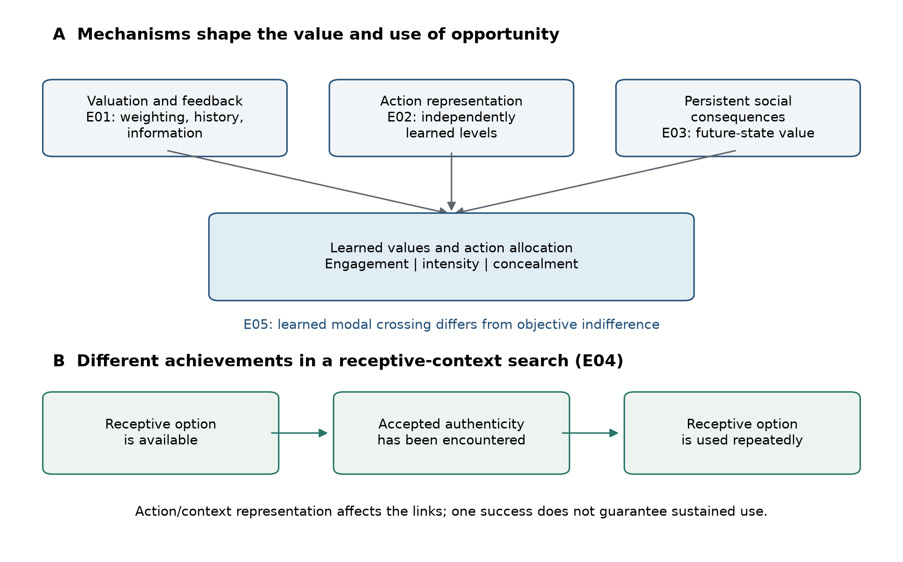
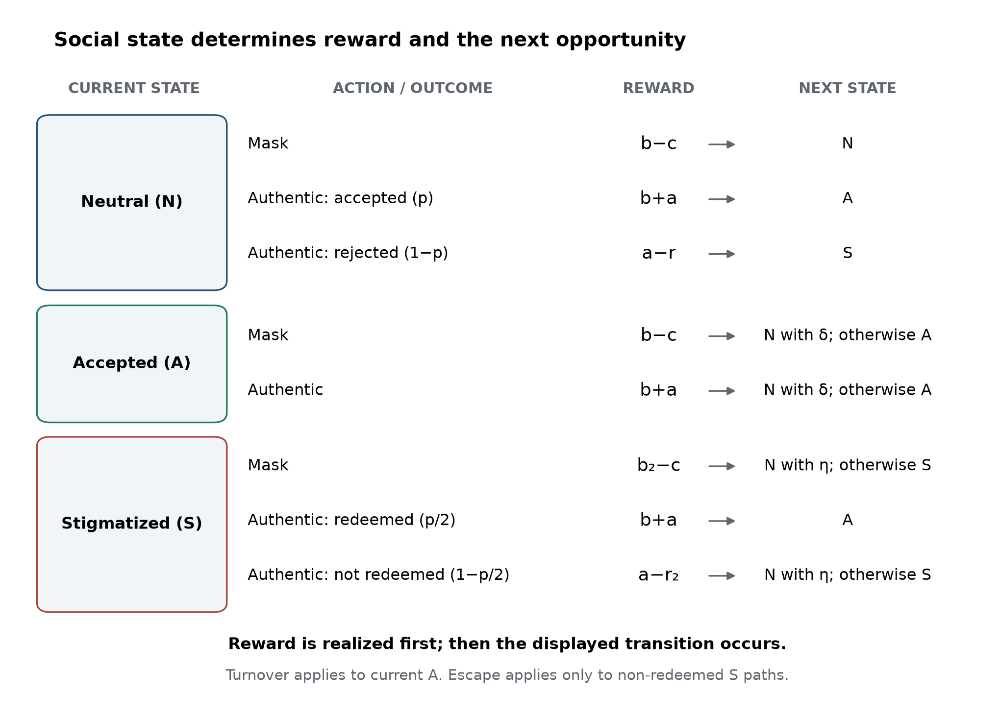
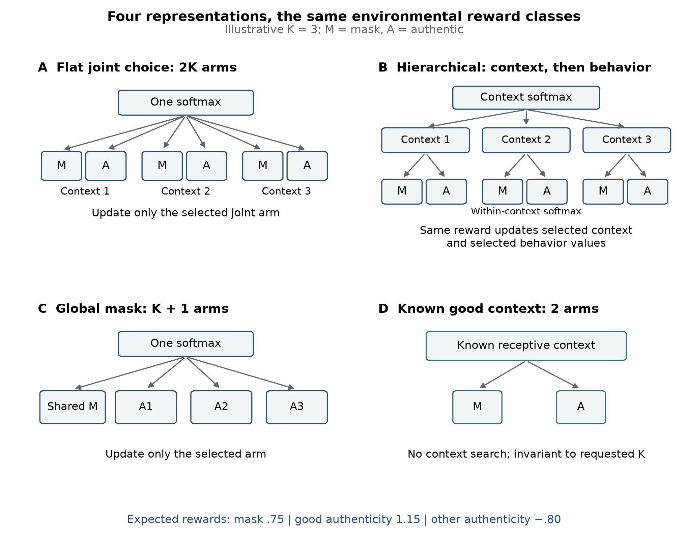
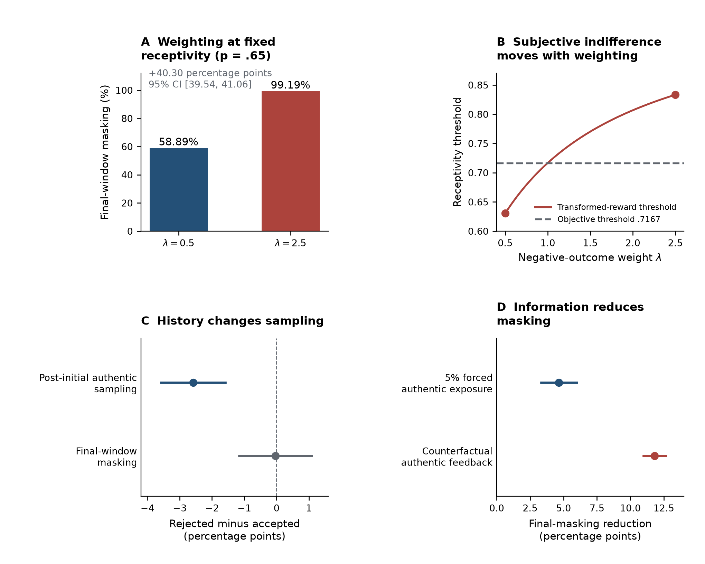
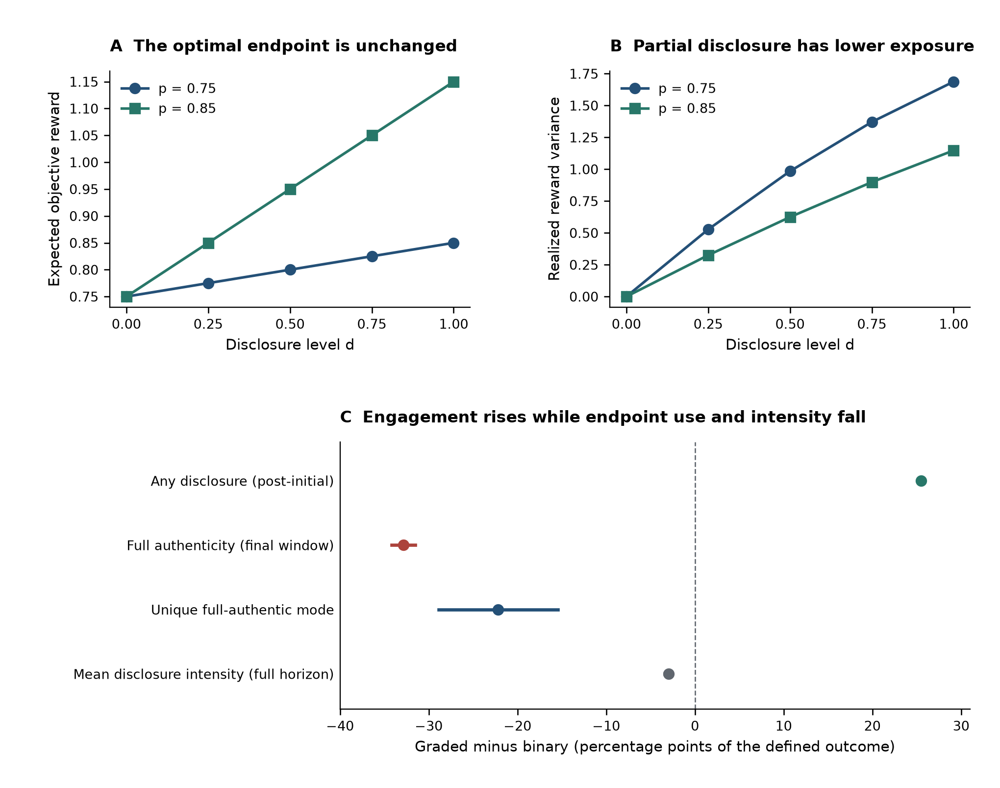
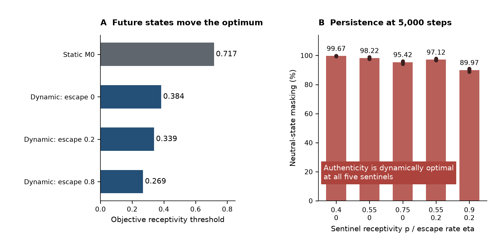
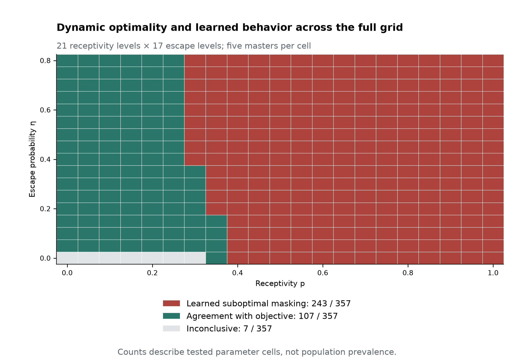
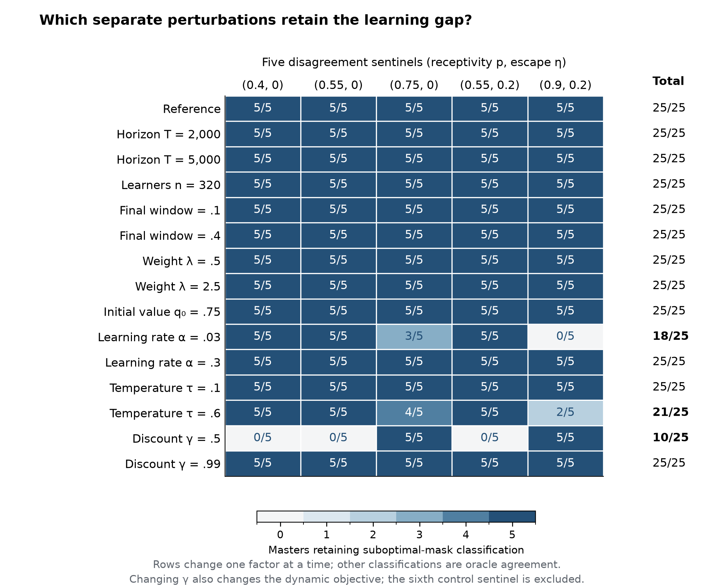
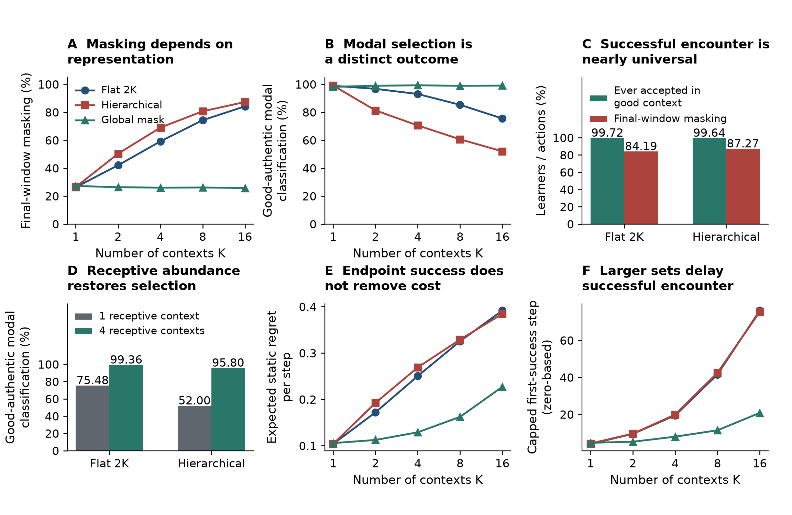
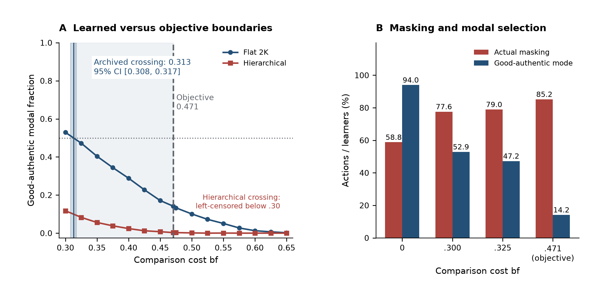

# How Learning and Social Opportunity Shape Ability Concealment: A Computational Study

**Guy Sion**¹, **Omer Moussaffi**²

¹ Gulbali Institute, Charles Sturt University, Boorooma Street, Locked Bag 588, Wagga Wagga, NSW 2678, Australia

² INGINIVIEW, Church Road, Durrus, Co. Cork, P75AK11, Ireland

**Corresponding author:** Guy Sion, Guy.Sion@mail.huji.ac.il

## Abstract

Gifted learners can manage ability visibility in response to social opportunities and consequences. Five reinforcement-learning experiments separated feedback, outcome weighting, action representation, persistent social state, and context structure. Graded options increased nonzero disclosure by 25.50 percentage points while reducing full-authentic endpoint use by 32.87 points and average disclosure intensity. Expanding contexts increased masking from approximately 26% to 84–87% under two representations, although over 99.6% of learners experienced accepted authenticity in the receptive context; a shared masking action preserved substantially lower masking. Persistent consequences shifted the objective receptivity threshold from .717 to .384–.269, while suboptimal masking persisted at five tested settings through 5,000 steps. The learned modal-population crossing occurred at comparison cost .313, below objective indifference at .471. These model results distinguish engagement, successful encounter, sustained expression, and objective value, identifying separate roles for information access, recovery, and opportunity representation in empirical research on concealment.

**Keywords:** giftedness; ability concealment; reinforcement learning; social opportunity; learning history

# 1. Introduction

## 1.1 Ability concealment as a heterogeneous educational phenomenon

Gifted young people can regulate the visibility of their ability, advanced interests, performance, or gifted identity. The stigma-of-giftedness and social-coping traditions describe information management, conformity, selective disclosure, denial of giftedness, and modified social interaction (Coleman & Cross, 1988; Cross et al., 1993; Swiatek, 1995). Recent accounts likewise describe both advantages and social costs associated with the gifted label (Klimecká, 2023). These findings make socially responsive visibility management an established starting point for explanation.

The relevant behaviour is heterogeneous. Social experiences vary across learners and settings (Cross et al., 2019), and high cognitive ability does not uniformly entail social or emotional difficulty (Lavrijsen & Verschueren, 2023; Tourreix et al., 2023). A learner may express an advanced interest with compatible peers, withhold it in another setting, or participate through a less conspicuous contribution. Selective expression can therefore reflect the relationship between a learner and an opportunity rather than a general disposition toward concealment.

We use *ability concealment* and *lower-visibility behaviour* for the narrow part of this strategy family represented here. Model *masking* is a low-visibility action; *authenticity* is the corresponding ability-expressive action. These operational labels do not equate privacy, conformity, underachievement, and clinical masking. The scientific problem is to explain how social consequences, experience, and available alternatives jointly shape expression.

## 1.2 From a behavioural observation to distinct mechanisms

Several routes can produce similar concealment. Adverse consequences can make expression costly; earlier feedback can lower expected returns; negative outcomes can receive greater weight; limited resampling can restrict corrective evidence; and the available choices can distribute learning across different actions. An explanation based solely on current environmental receptivity misses these learner-side and informational routes.

Equifinality provides the established principle that different pathways can lead to a similar endpoint (Cicchetti & Rogosch, 1996). The contribution of a computational analysis is to specify these pathways sufficiently to separate them. Holding environmental payoffs fixed while changing information or action representation tests one kind of explanation. Changing the persistence of social consequences tests another, because it can alter what behaviour is optimal rather than merely what the learner believes.

The resulting question is constructive: which changes alter concealment, by how much in a specified system, and through which channel? Answering it requires distinguishing environmental reward, learned expectations, experienced feedback, and observed action. It also requires measuring expression at more than one resolution. Any participation, average intensity, use of a particular endpoint, and the learner's most frequent individual action need not move together.

## 1.3 Sequential learning, information, and graded expression

Hot-stove learning supplies a familiar mechanism. An adverse outcome lowers an action's estimated value, which reduces later sampling and therefore the opportunity to acquire corrective evidence (March, 1996; Denrell & March, 2001). Choice changes both reward and information. Such sampling processes can generate persistent differences in estimates without a fixed preference against the avoided option (Denrell, 2005; Le Mens & Denrell, 2011).

This mechanism makes two useful predictions for a visibility problem. First, initial feedback can affect subsequent authentic sampling even with later environmental conditions held constant. Second, supplying otherwise unavailable information can change behaviour without improving the underlying payoff structure. These are demonstrations of established learning principles, but they identify concrete quantities that educational studies can measure: expected outcomes, experienced outcomes, and opportunities to revise expectations.

Graded expression introduces a different question. Partial participation offers lower exposure than full expression and may preserve engagement after rejection. Whether it also helps a learner approach fuller expression depends on how experience transfers across levels. If each level is learned separately, successful partial expression supplies no direct update to the value of full expression. Additional options may then increase the frequency of some expression while reducing its intensity and endpoint use. E02 isolates that possibility while keeping the best achievable expected reward unchanged.

## 1.4 Immediate reward and the value of future social opportunity

An action can also change the conditions under which later actions occur. Successful expression may establish acceptance; rejection may create adverse standing; and recovery may restore a neutral opportunity. Disclosure-process theory similarly treats decisions, events, and their subsequent consequences as a continuing process (Chaudoir & Fisher, 2010).

In such settings, immediate reward and dynamic value answer different questions. Authenticity with an unattractive immediate return may open a favourable future state. Conversely, an immediately attractive action may expose the learner to persistent costs. A dynamic benchmark allows both directions to be evaluated under the same explicit criteria.

The important questions are therefore quantitative as well as conceptual. How far can persistent consequences move the objective boundary between expression and concealment? Does making adverse standing easier to leave change that boundary? How closely do finite learners approach the resulting optimum, and does a gap persist with substantially more experience? E03 addresses these questions with an explicit state model and a full-information benchmark.

## 1.5 Availability, successful encounter, and sustained use

A favourable context contributes to behaviour through several distinguishable stages: it must exist, be sampled, yield an informative experience, and acquire enough learned value to receive continued use. Finding a receptive opportunity and repeatedly expressing ability within it are therefore different achievements. E04 tests them separately by varying the number, composition, and representation of contexts while preserving the best attainable reward.

Context also changes more than acceptance probability. A high-ability reference group can have social-comparison costs alongside its other advantages. Zeidner and Schleyer (1999) examined reference-group effects on academic self-concept, test anxiety, and grades among gifted children. We represent a comparison cost as an explicit payoff term, allowing its contribution to environmental value to be calculated separately from the population's learned response.

This yields two boundaries. The environmental boundary locates equality of objective rewards. A learned boundary locates a specified change in the population's behaviour after finite experience. Their separation is informative even when both respond in the expected direction to increasing cost. E05 estimates the latter and compares it with the exact former.

## 1.6 Present study and research questions

Five experiments organize the analysis (Figure 1). E01 tests feedback history, negative-outcome weighting, and corrective information. E02 tests whether independently learned graded actions separate engagement from intensity and endpoint use. E03 computes how persistent consequences and recovery relocate optimal behaviour, then tests the extent and persistence of learned suboptimal masking. E04 separates availability, successful encounter, sustained allocation, and search cost across context representations. E05 compares the learned modal-population boundary with environmental indifference.

The study combines three levels of contribution. Familiar learning mechanisms provide controlled demonstrations; giftedness research supplies expectations about socially responsive and selective expression; and the experiments identify less obvious combinations and magnitudes. Particular attention is given to engagement increasing while intensity falls, successful encounters coexisting with extensive masking, representation-dependent opportunity use, substantial dynamic-threshold shifts, and persistent separation between learned and objective behaviour.

**Figure 1. Learning mechanisms and the use of receptive opportunity.** **(A)** Valuation and feedback history (E01), action representation (E02), and persistent social consequences (E03) shape learned values and action allocation. Engagement, expression intensity, and concealment are distinct outcomes. E05 compares a learned modal-population crossing with objective indifference. **(B)** A receptive option being available, accepted authenticity being encountered, and the option being used repeatedly are different achievements. E04 varies action/context representation and receptive-context abundance to separate these outcomes. The diagram is a conceptual synthesis, not a fitted causal model or a quantitative result about children.

# 2. Model Framework and Methods

## 2.1 Common learner, outcomes, and evidential scope

The analyses concern the specified computational models and tested designs. They establish mathematical relationships and finite-learning effects, rather than estimates of human prevalence, developmental duration, or educational treatment efficacy. Reward units and learner parameters are normalized design variables; *objective* denotes the stipulated environmental reward and transition structure, not welfare or a recommendation to disclose. This scope applies to all results below.

The reference learner used initial values $Q_0=0$, learning rate $\alpha=.1$, softmax temperature $\tau=.25$, and negative-outcome weight $\lambda=1$. The transformed realized reward was

$$
v_\lambda(R)=\begin{cases}R,&R\geq0,\\ \lambda R,&R<0.\end{cases}
$$

In stateless models, only the selected action $x$ was updated:

$$
Q_{t+1}(x)=Q_t(x)+\alpha\{v_\lambda(R_t)-Q_t(x)\}.
$$

Actions followed softmax probabilities $\pi_t(x)\propto\exp\{Q_t(x)/\tau\}$, computed after subtracting the row maximum for numerical stability. Weighting changed the update, not environmental payoffs. Additional weighting and initialization conditions are identified explicitly.

Reference environmental parameters were $b=1$ (benefit), $a=.6$ (authenticity value), $c=.25$ (masking cost), and $r=2$ (rejection penalty). An outcome's environmental reward, transformed reward, sampled $Q$ estimate, and full-information dynamic value describe different quantities. In particular, an adverse-outcome weight is not an estimate of rejection probability.

Final-window outcomes used the last $\lceil .2T\rceil$ steps unless a sensitivity condition specified otherwise. We distinguish actual masking frequency, any-disclosure frequency, mean disclosure intensity, full-authentic endpoint frequency, and modal-action classification. Static objective regret averages the known expected-reward gap between the chosen action and the best available action. Encounter metrics record experienced outcomes. These outcomes describe different aspects of the same trajectory and are not interchangeable measures of success. The measurement conventions are summarized in Table 1.

**Table 1. Outcomes and their units of interpretation.**

| Outcome | Quantity summarized | Window or unit |
| --- | --- | --- |
| Nonzero disclosure | Fraction of choices with $d>0$ | E02 steps 1–1999 |
| Disclosure intensity | Mean chosen disclosure level $d$ | Full trajectory or final window, reported separately |
| Full-authentic frequency | Fraction of choices at $d=1$ | Final window |
| Modal classification | Whether the most frequent individual action meets the experiment's criterion | One indicator per learner; final-window counts |
| Total masking | Fraction of masking choices, summed across mask arms | Final window |
| Successful encounter | At least one accepted authentic action in a good context | One indicator per learner; full trajectory |
| First-success time | Zero-based first accepted-good step; non-events assigned $T$ | Capped at the full horizon |
| Static objective regret | Expected-reward gap between the best action and the action chosen | Mean over the full trajectory |
| Neutral-state masking | Masking count divided by all observed Neutral action counts | Aggregated within master and cell; final window |

E02 required a unique modal full-authentic action. E04 and E05 retained ties and used deterministic first-index resolution. Finite-window summaries describe action allocation at a stated horizon rather than a formal convergence criterion.

## 2.2 M0 and E01: feedback, weighting, and information

M0 offered masking ($M$) and authenticity ($A$). Masking returned $R_M=b-c$; authenticity returned $b+a$ with probability $p$ and $a-r$ otherwise. Thus

$$
\mathbb E[R_A]=a+pb-(1-p)r,\qquad
\Delta_0(p)=\mathbb E[R_A]-R_M=a+c-(1-p)(b+r).
$$

At $(b,a,c,r)=(1,.6,.25,2)$, masking returned $.75$, authenticity had expectation $-1.4+3p$, and objective indifference was $p^*=43/60=.716667$. When masking and accepted rewards are nonnegative and rejection is negative, subjective expected-reward indifference is

$$
p^*_{\lambda}=\frac{b-c+\lambda(r-a)}{b+a+\lambda(r-a)}
=\frac{.75+1.4\lambda}{1.6+1.4\lambda}.
$$

For $a+c>0$ and $r>a$, its derivative is $(r-a)(a+c)/[b+a+\lambda(r-a)]^2>0$. This is the threshold of expected transformed reward, distinguished from both the environmental boundary and an empirically fitted behavioural crossing.

In the controlled history experiment, every learner's step-0 action was authentic. Comparisons were conditioned on its accepted or rejected outcome at $p=.75$ and $.85$, then pooled equally within each master. The primary outcome was authentic sampling over steps 1–1999. Its normalized objective pseudo-regret contrast is exactly $-(1999/2000)$ times the sampling contrast. Final-window masking was secondary.

Two information treatments followed the same initial action. Forced exposure replaced 5% of post-initial choices with authenticity using a separate intervention stream. Counterfactual feedback supplied the authentic outcome associated with the same latent acceptance draw on a masking trial and updated the authentic estimate; its unchosen reward was not counted as realized return. Treatment contrasts used the rejected stratum. Archived weighting sensitivity included a maintained-baseline comparison of $\lambda=.5$ and $2.5$ at $p=.65$.

## 2.3 M1 and E02: graded action representation

M1 represented disclosure by $d\in[0,1]$, with masking at $d=0$ and full authenticity at $d=1$. Accepted disclosure returned $b+ad-c(1-d)$, whereas rejected disclosure returned $ad-c(1-d)-r$. Acceptance probability was $1-(1-p)d$, and

$$
\mathbb E[R(d)]=b-c+d\Delta_0(p).
$$

The objective is affine, so every disclosure grid containing both endpoints has the same maximum expected reward. Full authenticity is uniquely optimal above $p^*$, masking below it, and all levels tie at indifference. Rejection probability is $(1-p)d$, and the two possible rewards differ by $b+r$, giving

$$
\operatorname{Var}[R(d)]=(b+r)^2(1-p)d\{1-(1-p)d\}.
$$

E02 compared the binary set with five independent arms $d\in\{0,.25,.5,.75,1\}$. Experience at one level did not update another. The first action was full authenticity; headline contrasts used the rejected stratum at $p=.75$ and $.85$, equally weighted within master. The $p=.65$ condition was a control. Policy and environment streams were matched between architectures within receptivity and master.

Outcomes were post-initial nonzero disclosure, final-window full-authentic frequency, unique-modal full authenticity, and normalized objective pseudo-regret. The unique-modal classifier required strictly more endpoint selections than every other arm. In authenticity-optimal cells, normalized regret equals the full-horizon mean endpoint distance,

$$
\overline{\mathrm{Regret}}_{\mathrm{norm}}
=\frac1T\sum_{t=0}^{T-1}(1-d_t)=1-\bar d_{0:T-1}.
$$

This identity concerns all $T$ steps, whereas the direct final-window intensity estimate concerns only the last 400. Normalized regret therefore also measures full-horizon disclosure intensity, without constituting independent corroboration of that intensity difference.

## 2.4 M2 and E03: persistent state and dynamic value

M2 used Neutral ($N$), Accepted ($A$), and Stigmatized ($S$) states. All learners began in Neutral with every state-action value initialized at $Q_0$. Reward preceded the next-state transition. In $N$, masking returned $b-c$ and retained $N$; authentic acceptance returned $b+a$ and moved to $A$, whereas rejection returned $a-r$ and moved to $S$. In $A$, masking returned $b-c$ and authenticity $b+a$; either action was followed by turnover to $N$ with probability $\delta$, otherwise $A$ persisted. In $S$, masking returned $b_2-c$, followed by escape to $N$ with probability $\eta$. Authenticity redeemed with probability $p/2$, returned $b+a$, and moved to $A$. Failed redemption returned $a-r_2$, followed by escape to $N$ with probability $\eta$ or persistence in $S$. Reference values were $b_2=.5$, $r_2=2.5$, and $\delta=.02$.

The learner used state-action Q-learning with $\gamma=.9$:

$$
Q_{t+1}(s_t,x_t)=Q_t(s_t,x_t)+\alpha\left[v_\lambda(R_t)+\gamma\max_{x'}Q_t(s_{t+1},x')-Q_t(s_t,x_t)\right].
$$

Value iteration on untransformed environmental rewards and known transitions supplied the full-information, infinite-horizon discounted optimum. For continuation values $V$, the Neutral authentic-minus-mask advantage is

$$
D_N(V)=\Delta_0(p)+\gamma\{pV_A+(1-p)V_S-V_N\}.
$$

Dynamic thresholds were bracketed numerically. The value-iteration benchmark was independently checked against the deterministic-policy envelope over all 357 baseline cells. Value iteration started from $V_0=0$ and stopped when the maximum change across state values was below $10^{-10}$, with a fail-closed maximum of 100,000 iterations. Objective action ties used tolerance $10^{-10}$. Accepted-state dominance fixed its optimal action, leaving four deterministic policies for the independent comparison. Solver settings and the Bellman equation are collected in Appendix A. Two benchmark examples test reversals of immediate rankings: the reference environment at $(p,\eta)=(.4,0)$, and a harsh-consequence sentinel with $p=.75$, $b_2=0$, $r_2=8$, $\delta=.3$, $\eta=0$, and $\gamma=.9$.

The baseline grid crossed $p=0,.05,\ldots,1$ with $\eta=0,.05,\ldots,.8$. Within a master and cell, final-window Neutral counts were aggregated across 160 learners. Adequacy required at least 160 Neutral visits and 32 visiting learners; inadequate exposure or equal action counts was inconclusive. Learned suboptimal masking required adequate counts favouring masking while the oracle favoured authenticity. Stability required the same non-inconclusive classification in at least four of five masters.

Six prespecified sentinels were $(p,\eta)=(.35,0),(.4,0),(.55,0),(.75,0),(.55,.2),(.9,.2)$. The first supplied a boundary/agreement control; the remaining five formed the baseline-disagreement set. Archived sensitivity runs separately changed horizon to 2,000 or 5,000, population to 320, final-window fraction to .1 or .4, weighting to .5 or 2.5, or initialization to $Q_0=.75$. Further archived checks changed learning rate to $.03$ or $.3$, temperature to $.1$ or $.6$, and discount to $.5$ or $.99$. These were separate perturbations, not a factorial robustness sweep. Their complete classification outcomes are reported with the Results.

**Figure 2. Social states change rewards and future opportunity.** The M2 kernel contains Neutral (N), Accepted (A), and Stigmatized (S) states. Each card follows an action from its current state through realized reward to next state. Neutral masking remains Neutral. Authenticity from Neutral reaches Accepted with probability p and Stigmatized otherwise. In Accepted, both actions share the same turnover transition, but authenticity pays b+a rather than b-c; its immediate advantage is a+c=.85. In Stigmatized, authenticity redeems to Accepted with probability p/2. Masking and non-redeemed authenticity return to Neutral with escape probability eta; otherwise they retain Stigmatized. Reward is realized before the displayed transition. Turnover applies only when the current state is Accepted, and escape only to non-redeemed Stigmatized paths; neither changes the reward already earned. Reference values are b=1, a=.6, c=.25, r=2, b2=.5, r2=2.5, and delta=.02. This is a model specification diagram, not an estimated transition graph from children.

## 2.5 M3 and E04: context representation and opportunity use

M3 contained $K$ contexts. The primary design placed one good context with $p_G=.85$ among $K-1$ bad contexts with $p_B=.2$. Masking was context-invariant. A comparison cost $b_f$ reduced accepted authenticity only in a good context. The distinct objective reward classes were

$$
R_M=.75,\qquad \mathbb E[R_G]=1.15-.85b_f,\qquad \mathbb E[R_B]=-.8.
$$

At E04's $b_f=0$, the maximum was always $1.15$. Increasing $K$ changed the represented alternatives but not that best opportunity.

Four architectures separated representation from opportunity. The flat architecture used one softmax over $2K$ context–behaviour arms. The hierarchical architecture selected a context and then a behaviour, updating both selected values from the same reward. The global-mask architecture used one shared masking action and $K$ context-specific authentic actions. The fixed-known-good control offered two behaviours in a known good context. Values of $K$ were 1, 2, 4, 8, and 16. The requested design also crossed fixed or random-per-learner good-context identity with one, two, or proportional-25%-good-context regimes. Their good-context counts were respectively $1$, $\min(2,K)$, and $\max(1,\lceil K/4\rceil)$; the proportional rule rounds upward and guarantees at least one good context. Equivalent requests were canonicalized: 120 requested rows mapped to 55 executable cells. For example, a fixed-known-good learner has the same two-action task regardless of the requested number of contexts. Canonicalization avoids treating duplicated tasks as additional evidence.

In the flat and hierarchical representations, zero-based joint index $2g$ denotes masking in context $g$ and $2g+1$ authenticity there. The hierarchical learner updates both the selected context value and the selected within-context behaviour value from the same transformed reward. This differs from either pooling the values of all mask actions or equipping the learner with a model of the context's reward distribution. The architecture diagram in Figure 3 makes those information-sharing differences explicit.

The primary classifier applied deterministic first-index `argmax` to final-window joint-action counts and recorded whether the selected arm was authentic in a good context. Unlike E02, ties were retained and resolved by index. An additional strict unique-mode diagnostic assessed whether that tie convention determined the principal architecture contrasts. Secondary outcomes included total masking across all masking arms, ever experiencing accepted authenticity in a good context, capped time to that first success, and objective regret over all 2,000 steps. First-success time used the zero-based step, with non-events coded at 2,000. Abundance effects were assessed by differences in response slopes per $\log_2K$, with endpoint means supplied for interpretation.

**Figure 3. Four ways to represent the same context and behavior problem.** An illustrative K=3 makes the action organizations visible; it is a diagram, not an additional simulated condition. M denotes masking and A authenticity. **(A)** Flat choice uses a single softmax over 2K context-behavior arms and updates only the selected arm. **(B)** Hierarchical choice first selects one of K contexts and then masking or authenticity within it. The same realized subjective reward updates the selected context value and the selected within-context behavior value. **(C)** Global masking uses one shared mask arm plus K context-specific authentic arms, updating only the selected arm. **(D)** The known-good-context control offers two actions in an already identified receptive context and is invariant to requested K. At zero comparison cost, the three environmental expected-reward classes are .75 for masking, 1.15 for authenticity in the receptive context, and -.80 for authenticity in other contexts. Keeping those reward classes fixed makes representation and search burden distinct experimental factors.

## 2.6 E05: environmental and learned population boundaries

E05 fixed $K=4$ and one good context. Its objective good-authentic advantage was $.40-.85b_f$, so environmental indifference occurred at $b_f^*=8/17=.470588\ldots$. The accepted realized reward was $1.6-b_f$; the expected good-context reward was $1.15-.85b_f$.

The learned response was the proportion of learners whose deterministic final-window modal arm was the single good-authentic arm in the flat eight-action architecture. The full cost grid was

$$
b_f\in\{0,.30,.325,.35,.375,.40,.425,.45,8/17,.475,
.50,.525,.55,.575,.60,.625,.65,.80\}.
$$

The 16 points in $[.30,.65]$ resolved the crossing; zero and $.80$ were external endpoint diagnostics. Five complete master curves were averaged equally. A non-increasing, equal-weight pool-adjacent-violators fit (Best & Chakravarti, 1990) used $b_f=.30,.325,\ldots,.65$ plus the exact $8/17$ anchor. Its .5 crossing used a plateau midpoint or linear interpolation between adjacent fitted points. A crossing had to lie strictly inside $(.30,.65)$; a curve already below .5 was left-censored without extrapolation.

Ten thousand bootstrap samples resampled five complete master curves, refitted, and reinverted them. Percentile limits required at least 95% valid in-range crossings. Actual total-masking rates were reported separately, including the archived zero-cost anchor. The population modal crossing is neither a two-action softmax equality nor a threshold at which total masking first exceeds 50%.

## 2.7 Simulation design, inference, and reproducibility

Table 2 summarizes the standard run sizes and independent master-seed sets. The final window begins at $T-\lceil fT\rceil$ using zero-based indices, with $f=.2$ unless explicitly changed.

**Table 2. Standard simulation designs.**

| Experiment | Learners per cell | Steps $T$ | Final-window steps | Five master seeds |
| --- | ---: | ---: | --- | --- |
| E01: feedback and information | 500 | 2000 | 1600–1999 | 2026081101–2026081105 |
| E02: graded expression | 500 | 2000 | 1600–1999 | 2026081201–2026081205 |
| E03: baseline state grid | 160 | 1000 | 800–999 | 2026081301–2026081305 |
| E04: contexts | 500 | 2000 | 1600–1999 | 2026081401–2026081405 |
| E05: comparison cost | 500 | 2000 | 1600–1999 | 2026081501–2026081505 |

Scalar contrasts were first reduced within master, so learners, outcome strata, and parameter cells were not additional top-level replicates. Scalar contrasts used Student-$t$ 95% intervals across the five master estimates, with four degrees of freedom. Intervals for additional outcomes were pointwise. E03 used the stated classification rules; E05 used whole-curve bootstrap inference.

We distinguish exact reward identities, deterministic dynamic benchmarks, replicated planned contrasts, and archived secondary outcomes. Secondary outcomes retain that design status when reported in the main text. Tables of descriptive endpoint means use equal-weight master-cell averages and are accompanied by the relevant archived contrasts where available.

Appendix A, included in this article, documents configurations, seed hierarchies, artifact identities, and uncertainty calculations. Result manifests and content hashes identify the scientific evidence. Exact historical generator states for E01–E03 are incompletely recoverable, so their archived outputs, configurations, hashes, and verification records govern the retained results rather than a claim of bit-identical regeneration from current code. All numerical findings derive from the archived E01–E05 experiments or their documented mathematical benchmarks.

# 3. Results

## 3.1 Feedback, outcome weighting, and corrective information change concealment

With environmental receptivity fixed at $.65$, the archived weighting contrast increased final-window masking from 58.89% at $\lambda=.5$ to 99.19% at $\lambda=2.5$: a 40.30-percentage-point increase (95% CI 39.54–41.06; Figure 4). The environmental optimum remained masking at this receptivity. The effect identifies a large learner-side contribution to behavioural variation under unchanged payoffs.

The expected-transformed-reward boundary explains its direction. Subjective indifference rose from $.630435$ to $.833333$, while objective indifference remained $.716667$. At $\lambda=2$, the interval $.716667<p<.806818$ objectively favours authenticity while the transformed-reward comparison favours masking. Weighting therefore changes the learner's valuation target independently of environmental value.

The controlled history comparison demonstrated the expected hot-stove effect. An initially rejected authentic outcome reduced subsequent authentic sampling by 2.58 percentage points (95% CI 1.59–3.58), pooled across $p=.75$ and $.85$. The corresponding normalized objective pseudo-regret increase was $.025824$ [$.015914,.035735$], the action-count translation of the sampling effect. The final-window masking contrast was $-.000343$ [$-.011605,.010918$]; the detected history effect concerned subsequent sampling rather than a persistent final-window difference in this comparison.

Corrective information changed both behaviour and objective loss. Within the rejected stratum, 5% forced exposure reduced final masking by 4.66 points [3.32, 6.00] and normalized regret by $.057954$ [$.045614,.070293$]. Counterfactual authentic feedback reduced masking by 11.81 points [10.97, 12.66] and normalized regret by $.141318$ [$.132369,.150267$]. Environmental payoffs were unchanged.

The tested counterfactual treatment produced a larger masking reduction, with disjoint intervals and a descriptive ratio of approximately 2.54 to the forced-exposure reduction. This compares the specified information treatments at their tested intensities. Together, the results demonstrate separate effects of outcome valuation, acquired experience, and access to corrective evidence.

**Figure 4. Weighting, feedback history, and information change learned behavior.** **(A)** With receptivity fixed at p=.65, final-window masking increased from 58.89% at lambda=.5 to 99.19% at lambda=2.5. The contrast was +40.30 percentage points (95% CI [39.54, 41.06]); bars are equal-weight means of five master-seed estimates, not confidence limits. **(B)** The exact transformed-reward threshold is (.75+1.4 lambda)/(1.6+1.4 lambda), increasing from .6304 to .8333 between these weights while objective indifference remains .7167. **(C)** Initial rejection, relative to acceptance, reduced subsequent authentic sampling by 2.58 points (95% CI [-3.58, -1.59] for rejected minus accepted), whereas the final-window masking contrast was -0.034 points [-1.161, 1.092]. **(D)** Within the rejected stratum, 5% forced authentic exposure and counterfactual authentic feedback reduced final masking by 4.66 [3.32, 6.00] and 11.81 [10.97, 12.66] points, respectively. These are two specified information manipulations, not intensity-matched treatments. Panels C-D pool p=.75/.85 with equal weighting. Their intervals, and the contrast interval in A, are the archived Student-t 95% intervals across five independent master seeds. E01 used 500 learners and 2,000 steps per cell, with the last 400 steps defining the final window.

## 3.2 Graded options increase engagement while reducing intensity and endpoint use

Adding independently learned intermediate actions preserved more expression after rejection but reduced its intensity and use of the best endpoint (Figure 5). In the authenticity-optimal $p=.75/.85$ comparison, nonzero disclosure increased by 25.50 percentage points [25.30, 25.71], while full-authentic final-window frequency fell by 32.87 points [31.53, 34.20]. The probability that full authenticity was the unique modal action fell by 22.17 points [15.47, 28.88].

Normalized objective regret increased by $.029761$ [$.025648,.033874$]. Because regret equals $1-\bar d$ in these cells, average disclosure intensity over the full measurement horizon decreased by the same amount. The direct final-window intensity result agreed in direction: the graded-minus-binary mean-disclosure contrast was $-.032088$ [$-.038941,-.025236$] on the unit disclosure scale. This is a separately defined final-window outcome, whereas the preceding intensity estimate is the exact translation of full-horizon regret. More frequent *some* expression therefore coexisted with less intense expression and less frequent selection of the objectively best action.

The objective optimum was unchanged. Under the reference payoffs, $\mathbb E[R(d)]=.75+d(3p-2.15)$; additional levels neither improved the best attainable reward nor shifted its boundary. They changed the learning problem by distributing experience across independent estimates.

Partial options also had a clear exposure–reward geometry. At $p=.75$ and $.85$, both rejection probability and reward variance increase with disclosure. For example, at $p=.75$, half disclosure has expected reward $.80$ and variance $.984375$, compared with $.85$ and $1.6875$ for full authenticity. Partial disclosure supplies a lower-exposure, lower-variance option at a lower expected return. The learner's demonstrated response is the joint engagement–intensity trade-off; the variance calculation characterizes the options without assigning the learner an additional measured variance preference.

**Figure 5. Graded options preserve engagement while reducing endpoint use and intensity.** **(A)** At p=.75 and .85, expected reward is affine in disclosure level d, with full authenticity (d=1) optimal in both cases. Adding intermediate actions leaves the endpoint optimum unchanged. **(B)** Partial disclosure lowers reward variance: Var(R)=9(1-p)d[1-(1-p)d]. Rejection probability is (1-p)d; this is exact payoff geometry, not evidence of an independently measured learner preference for low variance. **(C)** Following initial rejection, five independently learned graded actions, relative to binary choice, increased post-initial nonzero disclosure by 25.50 points [25.30, 25.71], changed full-authentic final-window selection by -32.87 points [-34.20, -31.53], and changed unique full-authentic modal classification by -22.17 points [-28.88, -15.47]. Mean disclosure intensity over the full measurement horizon changed by -2.976 points of the unit disclosure scale [-3.387, -2.565]. The last contrast is an exact re-expression of the archived normalized-regret contrast, because normalized objective regret is 1-mean(d) in these cells; it is not an independent outcome. The different time windows and denominators are shown in the labels. Intervals are archived Student-t 95% intervals across five independent master seeds, pooling p=.75/.85 with equal weighting. E02 used 500 learners and 2,000 steps per cell, with a 400-step final window. Experience at one graded level did not update neighboring levels.

## 3.3 Persistent consequences relocate optimal behaviour, while suboptimal masking persists

### 3.3.1 Dynamic value changes the optimal action

Persistent social states shifted the Neutral-state boundary for optimal authenticity far below static indifference (Figure 6). At recovery probabilities $\eta=0,.2,$ and $.8$, the dynamic threshold was approximately $.384,.339,$ and $.269$, respectively, compared with $.717$ in the static model. The numerical brackets were [$.3839111,.3839722$], [$.3387451,.3388062$], and [$.2689819,.2690430$]. An independent deterministic-policy calculation agreed with the value-iteration envelope across all 357 baseline cells to a maximum discrepancy of $8.99\times10^{-10}$.

Raising recovery from zero to $.8$ therefore lowered the optimal receptivity threshold by approximately $.115$. Recovery changes the objective incentive to attempt expression, because an adverse state becomes less costly to enter. Established acceptance supplies the complementary benefit: both actions have identical continuation probabilities in $A$, so authenticity strictly dominates masking there by $a+c=.85$. In the reference Stigmatized state, immediate authentic expectation is $-1.9+1.75p$, always below masking's $.25$; any optimal authenticity in that state is supported by future redemption value.

Computed examples demonstrate both directions of payoff-ranking reversal. At $p=.4$, $\eta=0$, authentic immediate expectation is $-.20$, compared with $.75$ for masking, yet its dynamic Neutral-state advantage is $+.042943$. In the harsh-consequence sentinel, authenticity has an immediate advantage of $+.10$ but a dynamic advantage of $-.406293$; masking is optimal. Future consequences can thus make immediately costly expression worthwhile or make immediately favourable expression inferior.

**Figure 6. Persistent social state relocates objective thresholds and sustains a learning gap.** **(A)** The static authenticity threshold is .7167. The full-information dynamic Neutral-state thresholds are approximately .38394, .33878, and .26901 at escape rates eta=0, .2, and .8. Bars use the midpoints of archived numerical brackets of width .00006104; these brackets are computational precision intervals, not statistical confidence intervals. **(B)** At five prespecified disagreement sentinels, extended-horizon runs at T=5,000 retained aggregate Neutral-state masking while the dynamic oracle favored authenticity in every master. From left to right, the (p,eta) pairs are (.4,0), (.55,0), (.75,0), (.55,.2), and (.9,.2), with mean Neutral masking of 99.67%, 98.22%, 95.42%, 97.12%, and 89.97%. Bars are equal-weight means of five master-seed fractions and dots are the five individual fractions. These archived secondary sensitivity runs used n=160 and the last 20% of steps; the denominator is observed Neutral-state actions, not all actions or a fraction of learners. The displayed persistence does not assert asymptotic irreversibility.

### 3.3.2 A full-grid comparison reveals extensive learned–objective disagreement

Finite learning did not generally attain the dynamically favourable opportunity. In the same 243 of 357 baseline cells in every master replication, final-window Neutral counts favoured masking although the oracle favoured authenticity. All 243 had adequate exposure and agreement across five masters. Across the grid, 350 cells met the four-of-five stability rule; seven were inconclusive because of insufficient exposure or insufficient cross-master classification coverage. The full partition was 243 suboptimal-mask cells, 107 agreement cells, and seven inconclusive cells (Figure 7). Five of the inconclusive cells had inadequate Neutral exposure in every master. At $p=.25$ and $.30$ with $\eta=0$, respectively one and two masters had adequate exposure and agreement, below the stability criterion. These are counts of tested parameter cells, not a prevalence estimate.

The map adds an important distinction to the threshold comparison. The objective calculation identifies where authenticity is worthwhile with known transitions and rewards; the classified simulation grid identifies where the experienced learner actually allocates more Neutral actions to masking. A solver-defined opportunity boundary and a learned allocation pattern are therefore displayed as separate objects. Agreement is also retained as a result rather than treating the grid as uniformly discrepant.

**Figure 7. The full dynamic grid separates agreement, suboptimal masking, and inconclusive cells.** The 21 by 17 reference grid crosses receptivity p=0,.05,...,1 with escape eta=0,.05,...,.8. Each displayed square is one parameter cell summarized from five independent master seeds, with n=160 learners, T=1,000 steps, and a final 200-step window per master. The publication categories partition all 357 cells: 243 show learned suboptimal masking, 107 show agreement with the objective benchmark, and seven are inconclusive. The 243 suboptimal-mask cells have adequate Neutral-state exposure, aggregate learned preference for masking, and a full-information dynamic authenticity optimum in all five masters. Stable non-inconclusive classification requires agreement in at least four of five masters. Five inconclusive cells lack adequate exposure in every master; at (p,eta)=(.25,0) and (.30,0), only one and two masters, respectively, have adequate agreement. Exposure requires at least 160 Neutral visits and 32 visiting learners per master. Categories are taken directly from the frozen publication map. These are tested parameter-cell counts, not population prevalence or classifications of individual learners.

### 3.3.3 The gap persists across extended experience, with informative sensitivity exceptions

The archived sensitivity analysis showed substantial persistence. At all five prespecified disagreement sentinels, every master retained aggregate suboptimal Neutral masking under each separately tested perturbation: 2,000 or 5,000 steps, 320 learners, final-window fractions $.1$ or $.4$, weighting $.5$ or $2.5$, and initialization $.75$. At 5,000 steps, equal-weight mean Neutral masking was 99.67%, 98.22%, 95.42%, 97.12%, and 89.97% for the five ordered sentinels. The objective action remained authenticity. The result is persistent suboptimal action allocation relative to the specified full-information dynamic objective, with high masking even after a fivefold horizon extension.

Figure 8 displays the complete separately executed sensitivity set. Baseline and eleven perturbation rows retained all 25 suboptimal-mask cell-master classifications across the five disagreement sentinels. Three settings changed some classifications: $\alpha=.03$ retained 18/25, with seven oracle agreements; $\tau=.6$ retained 21/25, with four agreements; and $\gamma=.5$ retained 10/25, with 15 agreements. The companion settings $\alpha=.3$, $\tau=.1$, and $\gamma=.99$ retained 25/25. Thus persistence was broad across the executed checks, while the learner's update and exploration settings, and the discount defining future value, could change its relation to the benchmark.

Discounting deserves separate interpretation because changing $\gamma$ changes the objective comparator itself. The sixth, boundary/agreement sentinel $(.35,0)$ was outside the five-sentinel denominator; at $\gamma=.99$, it changed from reference agreement to learned suboptimal masking. These outcomes reveal structured sensitivity, not a single all-or-none verdict of robustness. Classification counts are direct summaries of archived runs, not new inferential tests.

**Figure 8. Persistence is broad across separate perturbations, with identifiable exceptions.** Each matrix entry is the number of five master seeds retaining the learned-suboptimal-mask classification at one prespecified disagreement sentinel; the adjacent total sums five sentinel columns to a denominator of 25 cell-master classifications. Rows are separate executed one-factor changes from the reference setting, not a joint factorial experiment. Baseline and 11 perturbation rows retain 25/25 classifications. Lowering alpha to .03 retains 18/25; raising tau to .6 retains 21/25; lowering gamma to .5 retains 10/25. All remaining classifications in these rows agree with the dynamic oracle; none are inconclusive. The discount factor gamma changes both the learning target and the full-information objective. The boundary/agreement control (p,eta)=(.35,0) is excluded from this five-sentinel denominator. Counts summarize archived classifications without new estimation, uncertainty intervals, or simulation.

## 3.4 Receptive opportunities are encountered but not consistently used

Expanding one receptive context into a set of sixteen contexts strongly changed behaviour under two representations while leaving the best expected reward at $1.15$ (Figure 9). Actual final-window masking increased from 26.36% to 84.19% in the flat architecture, a rise of 57.83 percentage points [57.43, 58.22]. In the hierarchical architecture it rose from 26.45% to 87.27%, an increase of 60.82 points [60.21, 61.42].

This extensive masking coexisted with almost universal successful encounter. At $K=16$, 99.72% of flat learners and 99.64% of hierarchical learners had experienced accepted authenticity in the good context at least once. The opportunity was therefore not simply never encountered. Encounter timing still worsened: mean capped first-success time increased by 72.11 steps [64.96, 79.27] and 71.15 steps [66.65, 75.66], respectively. First acceptance and sustained later allocation describe different parts of the trajectory.

The primary modal classifier also declined. From $K=1$ to 16, good-authentic modal selection fell by 23.40 points [22.16, 24.64] in the flat architecture and 47.04 points [42.98, 51.10] in the hierarchical architecture. Randomizing good-context identity retained the declines. The separate strict unique-mode diagnostic also retained the directions of the flat and hierarchical contrasts, showing that their direction did not depend on allowing first-index modal ties. Hierarchical selection, as implemented here, did not preserve the favourable endpoint.

The global-mask representation produced a different pattern. Total masking changed from 27.23% to 25.77%, a reduction of 1.46 points [.62, 2.29]. Good-authentic modal selection increased slightly, from 98.16% to 99.04%, with a contrast of .88 points [.21, 1.55]. The fixed-known-good control had an exactly zero structural $K$ effect. These controls identify representation as part of the effect: duplicating context-specific masking options differs from sharing one masking action.

Preserved endpoint classification did not eliminate search cost. Across all 2,000 steps, the increase in expected static regret per step was $.287739$ [$.286203,.289275$] for flat learners, $.280625$ [$.279390,.281859$] for hierarchical learners, and $.121423$ [$.119686,.123159$] for global-mask learners. The latter also incurred a 16.16-step increase [14.49, 17.83] in capped first-success time. Final modal success and payoff accumulated during learning were separable outcomes.

More widespread receptivity substantially improved endpoint use. At sixteen contexts, increasing good contexts from one to four raised good-authentic modal classification from 75.48% to 99.36% in the flat architecture and from 52.00% to 95.80% in the hierarchical architecture. The corresponding proportional-abundance slope differences per $\log_2K$ were $+.060440$ [$.055044,.065836$] and $+.112240$ [$.104787,.119693$]. Context count, receptive share, and representation jointly determined how an unchanged best opportunity translated into behaviour.

**Figure 9. Representation separates encounter, sustained use, endpoint selection, and search cost.** Panels A-C and E-F use one receptive context among K=1,2,4,8,16 contexts, with fixed good-context identity and unchanged best expected reward 1.15. **(A)** Final-window masking rises from 26.36% to 84.19% in the flat 2K representation and from 26.45% to 87.27% in the hierarchical representation; under global masking it changes from 27.23% to 25.77%. **(B)** The fraction classified with a good-authentic final-window modal action is a different outcome; classification uses deterministic first-index argmax, retaining ties. **(C)** At K=16, 99.72% of flat learners and 99.64% of hierarchical learners experienced accepted authenticity in the good context, alongside 84.19% and 87.27% final-window masking. Successful encounter has a learner denominator; masking summarizes action fractions. **(D)** At K=16, increasing receptive contexts from one to four increases good-authentic modal classification from 75.48% to 99.36% (flat) and 52.00% to 95.80% (hierarchical). **(E)** Context expansion increases expected static regret per step, including under global masking despite its high final modal selection. **(F)** Mean time to the first accepted good-context authentic action also rises. Time is a zero-based first success index, with non-events capped at T=2,000. All displayed values are descriptive, equal-weight means across five master seeds; connecting lines are visual guides and no confidence bands are implied. E04 used 500 learners and 2,000 steps per cell, with a 400-step final window. A, C, E, and F display archived secondary outcomes; D displays endpoint means for the abundance control rather than the prespecified slope contrast.

## 3.5 The learned population boundary lies inside the objectively favourable region

Comparison cost reduced expected good-context authentic reward according to $1.15-.85b_f$ (Figure 10). With masking at $.75$ and bad-context authenticity at $-.8$, good authenticity was the unique optimal action below $b_f^*=8/17=.470588$; masking was optimal above it. At equality, good authenticity and the masking actions tied.

The flat $K=4$ population's good-authentic modal-classification curve crossed .5 at $b_f^L=.312852$ (95% whole-curve bootstrap CI $.307836$–$.316918$). All 10,000 bootstrap samples yielded valid in-range crossings. The learned crossing lay $.157736$ below environmental indifference. Good-context authenticity retained an expected-reward advantage of $.134076$ at that crossing, approximately one-third of its zero-cost advantage; transforming the crossing interval gives advantage bounds [$.130620,.138340$]. This separation occurred at $\lambda=1$.

Actual masking supplied complementary behavioural information. At costs $0,.30,.325,$ and $8/17$, final-window masking was 58.82%, 77.61%, 78.95%, and 85.20%. Corresponding good-authentic modal-classification rates were 94.00%, 52.92%, 47.24%, and 14.16%. At $.325$, authenticity still had an objective advantage of $.12375$.

These paired outcomes explain the crossing's meaning. One good-authentic arm can be a learner's most frequent individual action while masking, aggregated over four arms, occupies most selections. Consequently, the $.312852$ boundary locates a population modal-classification change, not the onset of majority masking. In the hierarchical architecture, the response was already below .5 at $.30$ and no bootstrap sample produced an in-range crossing; its boundary was left-censored below the resolved range. The demonstrated result is a substantial architecture-specific separation between learned population response and objective indifference.

**Figure 10. The learned modal crossing lies below objective indifference, while actual masking is a separate quantity.** **(A)** Archived, equally pooled master-seed response points are shown for the flat eight-action and hierarchical representations at K=4 and lambda=1. Connecting lines only join the archived points; they are not a newly fitted curve. The frozen flat good-authentic modal-population .5 crossing is .312852 (95% complete-master-curve bootstrap CI [.307836, .316918]), below the exact objective crossover 8/17=.470588. The narrow shaded strip marks the archived crossing interval; the light region separates learned and objective boundaries. At the learned crossing, good-context authenticity retains an expected reward advantage of .134076. The hierarchical crossing is left-censored below .30. No estimator or bootstrap was rerun to construct this figure. **(B)** At comparison costs 0, .30, .325, and 8/17, actual final masking is 58.82%, 77.61%, 78.95%, and 85.20%, whereas good-authentic modal classification is 94.00%, 52.92%, 47.24%, and 14.16%. Masking has an action denominator and modal classification a learner denominator; the .5 modal crossing is not the onset of majority masking. These bars are descriptive means of five master-seed estimates. E05 used 500 learners and 2,000 steps per cell, with a 400-step final window. Expected good-context authentic reward is 1.15-.85 bf, whereas the accepted realized reward is 1.6-bf.

## 3.6 Distinct mechanisms change behaviour, opportunity value, and their alignment

The experiments separate three explanatory roles. Feedback history, outcome weighting, information access, and action representation change behaviour while environmental payoffs remain fixed. Persistent consequences, recovery, and comparison cost change the objective value of expression. Context composition and representation govern how available opportunities are encountered and used.

Their joint implication is more specific than a multiple-cause account of masking. Increased engagement can accompany reduced intensity; successful encounter can accompany sustained avoidance; a favourable dynamic opportunity can remain underused after extensive learning; and a learned population transition can occur well inside the objectively favourable region. These distinctions identify different measurements and different points at which a change to the system can operate.

# 4. Discussion

## 4.1 From multiple explanations to a mechanism-specific account

The findings explain concealment through both opportunity value and the processes that turn opportunity into action. Some results are expected demonstrations: weighting negative outcomes more heavily changes valuation, early adverse feedback restricts sampling, and corrective information changes learning. Some reflect expectations from giftedness research: expression is selective, socially responsive, and context-sensitive (Coleman & Cross, 1988; Swiatek, 1995; Cross et al., 2019; Klimecká, 2023). Their role is to establish a coherent and relevant model.

The principal extensions are the conjunctions and their magnitude. Graded actions preserve engagement while diminishing intensity and endpoint use. Receptive opportunities are successfully encountered by almost everyone while most final actions remain masking. Changing how masking is represented sharply changes this response to context expansion. Persistent social states substantially relocate objective thresholds, yet extensive suboptimal masking survives additional learning. These results move the argument from generic equifinality to explicit, testable distinctions.

Behavioural heterogeneity can consequently arise from experience, weighting, representation, or environmental structure, without assigning it all to stable person characteristics. Likewise, similar concealment can involve different relationships to opportunity. The scientific task is to identify those relationships rather than infer them from visibility alone.

## 4.2 History, weighting, and information are distinct learner-side routes

E01 separates what happened, how its outcome was weighted, and what information followed. These routes need not be collapsed into a single construct such as rejection sensitivity. A learner can expect rejection frequently, assign a particularly high cost to rejection, or have too little corrective experience to revise an estimate. Each can support concealment through a different computational quantity.

The weighting result is especially useful as a demonstration of identifiability: the same environmental contingencies produced a 40.30-point masking difference. The analytic threshold shows why the direction is expected. The history comparison then shows how different experience changes subsequent sampling among otherwise equivalent learners. Finally, the information treatments establish that this channel can be altered while leaving the payoff structure fixed.

The larger effect of the tested counterfactual treatment is consistent with its provision of authentic feedback on masking trials. It does not require the learner to choose the risky action to acquire that information. The treatments differ in information amount and format, so their ratio describes these implementations rather than a cost-adjusted ranking. Empirical analogues should measure information received and belief change as well as overt participation.

## 4.3 Engagement is not expression intensity or endpoint learning

A gradual route is often attractive because it preserves participation. E02 gives that benefit together with a loss in full expression and objective performance. The combination matters: an intervention or environment could appear successful when judged by whether a learner participates at all and less successful when judged by how fully the learner expresses ability.

The representation explains how the combination can arise. Partial actions expose the learner to less rejection and lower variance in the relevant cells. They can accumulate favourable experience without transferring it to the full-authentic estimate. Since the payoff optimum is unchanged, the resulting deficit is a learning-allocation effect rather than evidence that the environment has made partial expression objectively best.

Selective visibility is already present in gifted social-coping accounts. The model adds a condition under which selectivity sustains engagement without serving as a bridge to fuller expression. The discriminating next test is generalization: do successful experiences at one visibility level update expectations at other levels? A design that measures such transfer, alongside frequency and intensity, can distinguish an effective graded pathway from a stable partial-expression endpoint.

## 4.4 Persistent consequences change incentives, and recovery is an environmental lever

E03 shows why immediate social responses are insufficient for evaluating adaptation. The value of expression includes access to future states. In the reference model, the reliable benefits of established acceptance shift optimal authenticity into receptivity regions where its immediate expected reward is markedly inferior. At $p=.4$, the learner gives up $.75$ of certain masking return for an authentic expectation of $-.20$, yet authenticity is dynamically optimal. Severe persistent consequences reverse the comparison in the other direction.

Recovery changes this balance directly. Lowering the duration of adverse standing reduces the long-run cost of an unsuccessful attempt and moves the optimal threshold. It is therefore different from reassuring a learner about an unchanged environment. The model supplies an explicit distinction between changing expectations and changing what the learner has reason to expect over time.

The learning results add a second problem. At the five prespecified sentinels, Neutral masking remained approximately 90–99.7% after 5,000 steps, despite a dynamic advantage for authenticity. The successful horizon, population, window, weighting, and initialization checks show that the baseline discrepancy was not confined to one short run or classifier setting. Within the tested learner, additional experience alone did not close the substantial gap from the known-model optimum at these settings.

For empirical work, the implication is to observe persistence and recovery as features of the environment: how long an adverse encounter affects reputation or access, whether acceptance improves subsequent reception, and what permits a return to a neutral starting point. These measures distinguish adaptive concealment under persistent costs from concealment maintained despite a favourable dynamic opportunity.

## 4.5 Availability, successful encounter, and sustained use are different achievements

The context results require a richer explanation than failure to find a good setting. At sixteen contexts, more than 99.6% of learners in the two affected architectures had experienced accepted authenticity in the good context. Nevertheless, masking occupied 84–87% of final-window actions. A successful encounter supplied some evidence but did not guarantee accurate valuation or sustained allocation.

Action representation had a large role. With one shared masking action, total masking remained near 26% and good-authentic modal classification remained above 98%. With context-specific masking, context expansion greatly increased masking. The hierarchical learner's separate context decision did not protect it in the tested formulation. These are positive findings about the decision structure, not merely qualifications of a general search effect.

Receptive abundance provides a complementary environmental result. Increasing the receptive share restored good-authentic modal selection substantially. That direction fits the context-sensitive account of visibility management in giftedness research; the controlled model identifies the contribution of abundance separately from the value of the best setting. At the same time, global-mask learners show that successful final classification can conceal considerable payoff cost incurred during search.

The educational distinction is therefore between making opportunity available, making its receptivity legible, supporting successful encounters, and sustaining its use. Each stage can be measured. An initial positive experience should not be treated as proof that the learner now knows the opportunity's value or will use it consistently.

## 4.6 Learned boundaries combine environmental value and learning architecture

Comparison-cost research motivates an environment in which a receptive high-ability setting can also carry a cost (Zeidner & Schleyer, 1999). E05 then distinguishes the exact point at which this cost removes the objective advantage from the point at which the learned modal-population response changes. The $.313$ versus $.471$ separation is sizeable and occurs without enhanced negative-outcome weighting.

Its interpretation depends on measuring the right response. A population can contain many learners whose most frequent individual action is good-context authenticity while aggregate masking remains high. Reporting the modal curve alone would hide that action allocation. Reporting only total masking would obscure the resolved modal-population transition. The two measures jointly characterize how the environment is used.

The experiment establishes the separation, not a unique decomposition of its contributors. Sampling, constant-step estimation, action competition, softmax temperature, and representation all sit between expected reward and the measured response. A behavioural threshold is consequently a property of the environment–learner system. Locating the environmental threshold requires independent reward information, while identifying the sources of the displacement requires additional controlled comparisons.

## 4.7 Empirical predictions and discriminating measurements

The model suggests a set of separable predictions. Corrective information should change expectations and subsequent sampling even when actual social responses remain constant. This can be tested with repeated expectation reports, observations of feedback, and later choices, keeping information exposure distinct from payoff improvement.

Greater recoverability should improve the anticipated long-run return to expression. Relevant measures include the duration of adverse consequences, opportunities to repair social standing, and subsequent access after acceptance or rejection. The distinction from the information prediction is essential: recovery changes the future consequence structure itself.

Effects of graded options should depend on cross-level generalization. Studies should measure whether a successful partial contribution changes expectations about a more visible contribution, and record any-expression frequency, intensity, and endpoint use separately. A receptive-context prediction likewise concerns both composition and repeated use: increasing the receptive share should be more supportive than adding predominantly unreceptive alternatives, while first successful encounter and later allocation can diverge.

Finally, learner weighting should be measured separately from expected outcome probability. Similar observed contingencies can support different action patterns when adverse outcomes carry different learned weights. Longitudinal, context-linked observations can combine these measures with within-person changes, helping distinguish stable differences from history-induced variation. The payoff of this programme is not a single concealment score but an explanation of which process changes which aspect of expression.

## 4.8 Educational relevance and implications

The following are model-derived assessment and intervention targets for empirical testing, not established educational protocols. Their shared aim is to improve the alignment of expectations, opportunity, and informed choice, rather than maximize visibility regardless of its consequences.

### 4.8.1 Start with mechanism, not masking

Assessment should connect behaviour to an explicit explanation. What currently follows expression? What does the learner expect? Which experiences informed that expectation? Are costs short-lived or persistent? Does the learner use partial expression, and does experience transfer across levels? Which receptive alternatives exist, have been encountered, and are used repeatedly? These questions distinguish environmental cost, acquired expectation, restricted information, and action representation without treating concealment itself as a diagnosis.

### 4.8.2 Assess expectations and outcome weighting

Expected probability and expected cost are different. Two learners may predict equally frequent rejection but assign it different significance; two others may value the same outcome similarly but predict different probabilities. Asking what would happen after an advanced answer, a request for harder work, or disclosure of an interest should therefore include both likelihood and consequence. Repeated comparisons of predictions with actual responses can reveal whether information changes expectations and subsequent sampling, the channel directly demonstrated in E01.

### 4.8.3 Support repeated use of receptive opportunities

Availability, legibility, encounter, and sustained use should be assessed separately. An enrichment setting or supportive adult may exist without being recognizable as receptive. A learner may then have one positive encounter without developing stable confidence in that setting or using it again. The E04 results motivate attention to repeated credible opportunities and to the proportion of settings that respond supportively, alongside signposting and initial access. Tracking later participation supplies information that a record of first attendance or first success cannot.

### 4.8.4 Make transfer across graded options visible

Partial-expression routes can preserve engagement. E02 suggests measuring whether they also help a learner infer the likely consequences of fuller expression. A teacher might examine whether success with a low-visibility contribution changes expectations about a more visible one, while observing participation frequency and intensity separately. The target is informative transfer across options, not an assumption that either gradual or all-or-nothing disclosure is universally preferable.

### 4.8.5 Match the change to the mechanism

Where concealment reflects persistent adverse consequences, the target is the environment and routes to recovery. Where expectations reflect incomplete or outdated evidence, the target is credible information. Where partial options remain informationally isolated, the target is generalization across them. Where receptive settings are scarce or inconsistently used, the targets include receptive abundance, accessibility, and repeated opportunity. The experiments distinguish these levers because changing beliefs, changing action representation, and changing long-run incentives are different operations. Matching the response to the mechanism is the central practical implication.

# 5. Limitations

The strongest checks concern the defined computational systems. Replicated master-seed contrasts support the principal simulation effects; exact identities fix static boundaries; an independently checked dynamic oracle supplies the E03 benchmark; and executed sentinel perturbations demonstrate persistence under the named changes. These strengths coexist with a specific range of generalization.

The learner is finite, tabular, and constant-step, with softmax sampling. Other priors, memory rules, generalization structures, or model-based planning can produce different behaviour. For E02 and E04, representation dependence is itself an experimental result. Its transfer to people requires evidence about how learners encode related actions and contexts. Successful encounter also records acceptance at least once, not verified knowledge of the entire payoff structure.

The dynamic oracle has full information and an infinite-horizon discounted objective, whereas simulated learners acquire information over a finite horizon. The benchmark establishes model-relative suboptimality, not a comparison between equally informed learning algorithms. Sentinel checks were targeted and separate; they do not establish robustness over every joint parameter combination or convergence as time becomes unbounded. Other executed changes in learning rate, temperature, and discounting changed some sentinel classifications, with discounting also changing the objective itself (Section 3.3.3 and Appendix A). Parameter-cell counts are coverage of a design space, not population frequencies.

Secondary outcomes improve the scientific account but retain their status and pointwise uncertainty. Three- and nine-level graded architectures and broad learner-parameter sweeps were not part of the reported evidence. Finally, the historical generator-state gap for E01–E03 limits exact regeneration from current source, although archived outputs and their integrity records support the reported estimates. These limitations specify the next computational and empirical tests without changing the demonstrated relationships.

# 6. Conclusion

Ability concealment is shaped by both the value of social opportunity and how learners experience and represent it. With payoffs fixed, feedback history, outcome weighting, information access, and action representation change behaviour. Persistent consequences and recovery change optimal behaviour itself. The resulting learned policy can remain far from the full-information optimum after substantial additional experience.

The most informative results separate outcomes that might otherwise be treated as equivalent. Graded choice can increase engagement while reducing expression intensity. Almost universal successful encounter with receptivity can coexist with extensive later masking. An action representation can preserve a favourable final endpoint while still imposing accumulated search costs. Learned population boundaries can lie well inside objectively favourable regions.

These findings support a mechanism-specific research programme for gifted learners: measure current contingencies, learned expectations, weighting, feedback, cross-action generalization, persistent consequences, and repeated contextual use separately. The question becomes which change—in information, recovery, representation, or opportunity composition—alters the observed pattern and why.

# Appendix A. Technical methods and evidence provenance

This appendix is part of the article. It records implementation and inferential details that support the integrated Methods and Results without repeating the scientific narrative.

## A.1 Objective benchmarks and numerical precision

Static objective regret uses known action expectations, not realized noisy reward:

$$
\overline{\mathrm{Regret}}_{\mathrm{static}}
=\frac1T\sum_{t=0}^{T-1}
\left\{\max_x\mathbb E[R_x]-\mathbb E[R_{x_t}]\right\}.
$$

For E01's authenticity-optimal binary cells, dividing by the authentic-minus-mask expected-reward gap converts regret into a mask fraction. Because every initial action was authentic, the history contrast is exactly $-(T-1)/T$ times the post-initial authentic-sampling contrast. For E02's affine payoff, the corresponding normalized expression is $1-\bar d$ over the full trajectory. These identities explain why a regret translation and the underlying allocation measure are not independent observations.

For M2, the known-model objective used the Bellman operator

$$
Q^V(s,x)=\sum_{s'}P(s'\mid s,x)
\{r(s,x,s')+\gamma V(s')\},\qquad
(\mathcal T V)(s)=\max_x Q^V(s,x).
$$

Here $r(s,x,s')$ denotes the environmental transition-reward function, distinct from the scalar rejection-penalty parameter $r$ elsewhere. The calculation uses untransformed rewards; learner weighting does not alter this environmental comparator. The reference solver settings are given in Section 2.4. Fixing the Accepted action to authenticity leaves the four combinations of Neutral and Stigmatized deterministic actions; their independently evaluated envelope agreed with value iteration over all baseline cells.

The complete objective-threshold brackets were [.383911133, .383972168] at $\eta=0$, [.338745117, .338806152] at $\eta=.2$, and [.268981934, .269042969] at $\eta=.8$. Each width was approximately .0000610352. Midpoints were .383941650, .338775635, and .269012451; the corresponding reductions from static indifference were .332725, .377891, and .447654. The midpoint difference between $\eta=0$ and $.8$ was .114929. These are deterministic numerical quantities, not intervals estimated from learners.

The separate harsh-kernel archive included $p=.70,.75,$ and $.80$; Section 3.3 reports the verified $.75$ ranking reversal. Archived learned-boundary searches in the dynamic model were censored and therefore do not supply a measured learned threshold to pair with its objective brackets. The reported learner–oracle comparison instead uses adequate final-window Neutral action counts and the full grid or named sentinels.

## A.2 Randomization and semantic stream construction

The complete master lists appear in Table 2. Semantic cell or family identifiers were SHA-256 hashed, and the first four little-endian 32-bit digest words entered NumPy's SeedSequence together with the master and experiment namespace. The hierarchy distinguished reproducible task identity from execution ordering.

E01 used namespace 1 and spawned two streams, separating the policy/environment sequence from the forced-exposure intervention sequence. E02 used namespace 2 and one stream reinitialized for the binary/graded comparison within master and receptivity. E03 used namespace 3; only approved horizon/window sentinels shared trajectory-prefix families. E04 used namespace 4 for policy/environment and namespace 40 for independent context identity. E05 used namespace 5 and reinitialized the policy/environment stream across comparison costs within architecture and master. Its bootstrap used master 2026081597, namespace 50, and the architecture code. Flat and hierarchical crossing curves belonged to separate stream families.

Child draws were vectorized within cell/family streams. E01's initially accepted and rejected strata were disjoint learners, not matched pairs. E02 matched latent uniform sequences and child identifiers between architectures within master and receptivity, not across receptivity or masters. E04 consumed acceptance uniforms on every trial in the maintained random-number order and reduced architecture/K effects within master. E05 pairing applied to costs within an architecture; resampling preserved each complete master curve.

These distinctions matter for inference: a child, a parameter cell, and a whole-master curve are not interchangeable replication units. Fixed master lists were not sampled from a documented population of seed values; the reported variability describes the specified independent replications.

## A.3 Uncertainty and evidence classes

For five scalar master-level effects $\theta_j$, the archived Student-$t$ interval was

$$
\bar\theta\pm t_{.975,4}\frac{s_\theta}{\sqrt5},
\qquad t_{.975,4}=2.776445.
$$

E01 and E02 first pooled the specified receptivity conditions equally within master. E04 first computed the relevant architecture contrasts or $\log_2 K$ slope contrasts within master. Secondary-outcome intervals are pointwise rather than simultaneous. Equal-weight descriptive endpoint levels are labelled as such; plotting them does not create confidence bounds. The E03 grid's repeated 243-cell classification documents stability across the five streams, not an estimate of zero model uncertainty. Its 25-denominator sensitivity totals are five cells times five masters.

E05's crossing interval differs from a scalar-effect interval. Five complete response curves were resampled with replacement 10,000 times; each draw was averaged, monotonically refitted, and reinverted. The bootstrap did not independently resample individual cost points or learners. A plateau at .5 supplied its midpoint; an ordinary crossing used linear interpolation. Curves without a strict in-range crossing remained invalid for that range rather than being extrapolated. Transforming the crossing limits through $.40-.85b_f$ reverses their order when expressing remaining objective advantage.

The evidence combines exact mathematical identities, deterministic numerical benchmarks, replicated planned contrasts, and archived secondary outcomes. Their different roles are retained even when all are discussed in the main narrative. The new diagrams and summary displays are deterministic presentations of those existing sources, not new experiments, bootstrap analyses, or estimates of human behaviour.

## A.4 Source artifacts and historical reconstruction

Five archived artifact families under the repository's results directories provide the numerical evidence:

- E01: **frontiers_hot_stove_v1**, including cells and effects.
- E02: **frontiers_m1_binary_graded_v1**, including cells, arm summaries, and effects.
- E03: **frontiers_m2_regime_replication_v1**, including cells, effects, stable-cell classifications, and thresholds.
- E04: **frontiers_m3_search_architectures_v1**, including response curves, effects, and the request-equivalence table.
- E05: **frontiers_m3_bflpe_crossover_v1**, including cells, analytic rewards, transitions, and effects.

Within the E01/E02 effect tables, headline contrasts select across-master estimates, equal weighting of $p=.75/.85$, and the initially rejected stratum where stated. E01's maintained weighting comparison instead selects $p=.65$ and $\lambda=2.5$ minus $.5$. E02's direct final-window intensity row is the graded-minus-binary mean-disclosure contrast. E03 selectors distinguish the exact grid, sentinels and sensitivity names, harsh-kernel cells, and objective dynamic-authenticity thresholds. E04 plotted endpoint levels select the named architecture, fixed identity, $K=1$ or 16, and the specified effective good-context count; Figure 9 also includes the full K curves. E05 selects architecture and cost, with the archived transition table supplying the fitted crossing and bootstrap validity.

Manifests retain normalized configurations, exact parameters, seed hierarchy, package versions, execution timestamps, source fingerprints, and output paths with SHA-256 hashes. Recorded experiments used Python 3.14.6 on macOS arm64 and NumPy 2.4.6; E01, E02, E04, and E05 also recorded Matplotlib 3.10.8. All 33 protected E01–E05 outputs are artifact-verified in the retained verification record.

Artifact verification, current-code reproducibility, and exact historical-source reconstruction are separate claims. Fingerprint-exact historical generator-source bundles are retained for E04 and E05. For E01–E03, historical source state remains unrecovered; the retained estimates are governed by archived outputs, configurations, hashes, and verification records. This does not imply that the archived outputs changed. It identifies the remaining source-level reconstruction limit.

The integrated figure-provenance record identifies exact input paths, hashes, selectors, displayed values, and output hashes. Read-only verification loads and rehashes the archived files; deterministic presentation reproduction does not require rerunning the simulations. Source-data and claim-route records remain available in the repository alongside the article.

## A.5 Executed coverage and next tests

The executed scope includes E03's full 357-cell reference grid and the separate sentinel changes enumerated in Section 2.4 and Figure 8; E04's four representations, identity controls, and one/two/proportional-good regimes; and E05's master curves, strict-mode diagnostic, flat crossing bootstrap, and hierarchical censoring. E01's maintained weighting result and controlled history/information outcomes, and E02's paired binary/graded contrasts, retain their original design status.

E01 horizon and learning-rate sweeps, E02 three- and nine-level grids, E04 receptivity and temperature sweeps, and E05 longer-horizon crossings were planned but not executed. They identify specific next computational tests and are not used to support the present results. No numerical result from the endogenous-receptivity M4/E06 extension is included. The present evidence addresses M0–M3 through E01–E05, with model-relative conclusions and empirical predictions as distinguished in the main article.

# Funding

This study was not funded.

# CRediT authorship contribution statement

**Guy Sion**: Conceptualization; Writing Original Draft; Writing Review & Editing; Final Approval of Submitted Version.

**Omer Moussaffi**: Formal Analysis (mathematical model development and simulation runs); Writing Original Draft; Writing Review & Editing; Final Approval of Submitted Version.

# Declaration of competing interests

None.

# Acknowledgements

This study has grown out of years of teaching gifted children, and of our own experiences as gifted children in school and in special day centers. We wish to express our gratitude to the late Mary Jane, the late Robert H. Asher, and the late Raphi Amram, as well as to the Israel Arts and Science Academy (IASA). Thanks to them, we met.

# Data and code availability

The project repository is publicly available at https://github.com/mousomer/gifted-masking. The exact content-addressed E01–E05 evidence package and its persistent archival identifier will be deposited before submission. The Methods and Appendix A within this article specify the model contracts, estimands, seed hierarchy, reported secondary outcomes, and provenance of the existing evidence. Supporting claim and figure-source records route each reported result to its archived table or mathematical authority; they do not replace the unresolved deposit requirement or the historical generator-state disclosure.

# References

Best, M. J., & Chakravarti, N. (1990). Active set algorithms for isotonic regression: A unifying framework. *Mathematical Programming, 47*(1–3), 425–439. https://doi.org/10.1007/BF01580873

Chaudoir, S. R., & Fisher, J. D. (2010). The disclosure processes model: Understanding disclosure decision making and postdisclosure outcomes among people living with a concealable stigmatized identity. *Psychological Bulletin, 136*(2), 236–256. https://doi.org/10.1037/a0018193

Cicchetti, D., & Rogosch, F. A. (1996). Equifinality and multifinality in developmental psychopathology. *Development and Psychopathology, 8*(4), 597–600. https://doi.org/10.1017/S0954579400007318

Coleman, L. J., & Cross, T. L. (1988). Is being gifted a social handicap? *Journal for the Education of the Gifted, 11*(4), 41–56. https://doi.org/10.1177/016235328801100406

Cross, J. R., Vaughn, C. T., Mammadov, S., Cross, T. L., Kim, M., O’Reilly, C., Spielhagen, F. R., Pereira Da Costa, M., & Hymer, B. (2019). A cross-cultural study of the social experience of giftedness. *Roeper Review, 41*(4), 224–242. https://doi.org/10.1080/02783193.2019.1661052

Cross, T. L., Coleman, L. J., & Stewart, R. A. (1993). The social cognition of gifted adolescents: An exploration of the stigma of giftedness paradigm. *Roeper Review, 16*(1), 37–40. https://doi.org/10.1080/02783199309553532

Denrell, J. (2005). Why most people disapprove of me: Experience sampling in impression formation. *Psychological Review, 112*(4), 951–978. https://doi.org/10.1037/0033-295X.112.4.951

Denrell, J., & March, J. G. (2001). Adaptation as information restriction: The hot stove effect. *Organization Science, 12*(5), 523–538. https://doi.org/10.1287/orsc.12.5.523.10092

Klimecká, E. (2023). Advantages and disadvantages of being ‘gifted’: Perceptions of the label by gifted pupils. *Research Papers in Education, 38*(6), 902–923. https://doi.org/10.1080/02671522.2022.2065523

Lavrijsen, J., & Verschueren, K. (2023). High cognitive ability and mental health: Findings from a large community sample of adolescents. *Journal of Intelligence, 11*(2), Article 38. https://doi.org/10.3390/jintelligence11020038

Le Mens, G., & Denrell, J. (2011). Rational learning and information sampling: On the “naivety” assumption in sampling explanations of judgment biases. *Psychological Review, 118*(2), 379–392. https://doi.org/10.1037/a0023010

March, J. G. (1996). Learning to be risk averse. *Psychological Review, 103*(2), 309–319. https://doi.org/10.1037/0033-295X.103.2.309

Swiatek, M. A. (1995). An empirical investigation of the social coping strategies used by gifted adolescents. *Gifted Child Quarterly, 39*(3), 154–160. https://doi.org/10.1177/001698629503900305

Tourreix, E., Besançon, M., & Gonthier, C. (2023). Non-cognitive specificities of intellectually gifted children and adolescents: A systematic review of the literature. *Journal of Intelligence, 11*(7), Article 141. https://doi.org/10.3390/jintelligence11070141

Zeidner, M., & Schleyer, E. J. (1999). The big-fish-little-pond effect for academic self-concept, test anxiety, and school grades in gifted children. *Contemporary Educational Psychology, 24*(4), 305–329. https://doi.org/10.1006/ceps.1998.0985
