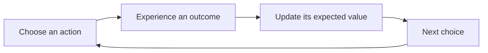
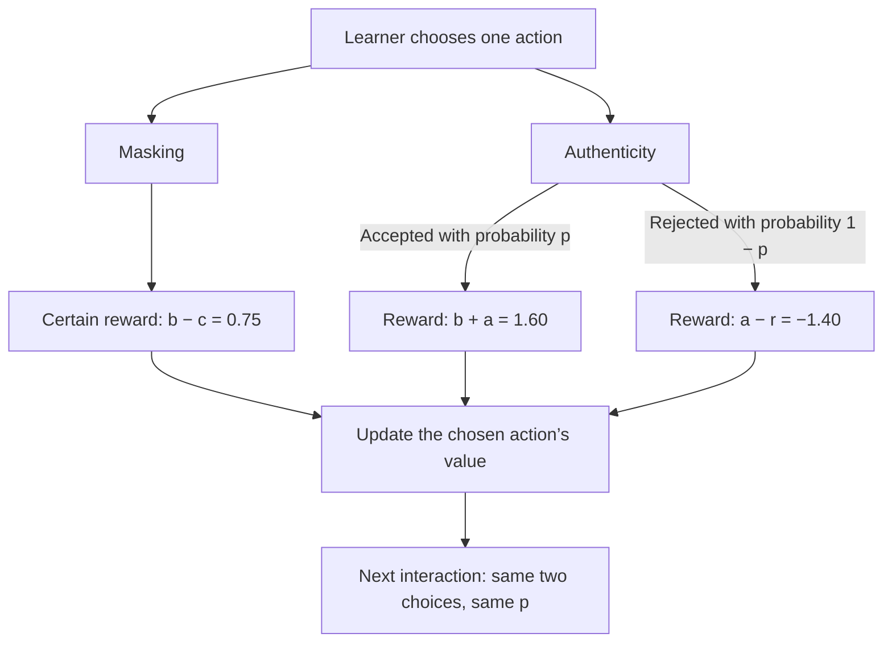

# Opening slides and M0: presentation plan

Documented 6 October 2026. This is the author-directed plan for S01–S04, followed by the remaining models in [PPT_STORYBOARD.md](PPT_STORYBOARD.md). The active talk has eleven main slides, 660 seconds of speaking, and a 60-second reserve. The first four slides take 3:10. Eight backup slides remain outside the timed talk.

This document specifies copy, diagrams, image composition, narration, and evidence. It does not generate images or edit the PowerPoint. The existing S01 PPTX predates this plan and requires revision. Model code and archived results remain unchanged.

## Sequence and timing

| Slide | Title | Time | Finish | Purpose |
| --- | --- | ---: | ---: | --- |
| S01 | What mechanisms could explain masking? | 0:35 | 0:35 | Establish the phenomenon and leave the explanation open |
| S02 | A close second | 0:30 | 1:05 | Illustrate explicitly encouraged restraint using Dash |
| S03 | Learning from social experience | 0:45 | 1:50 | Explain the common learner and distinguish it from direct instruction |
| S04 | M0: masking or authenticity | 1:20 | 3:10 | Draw the two-arm setup; separate analytic value from simulated behaviour |

The remaining model slides keep their previous durations. The evidence slide is 35 seconds and the conclusion is 30 seconds, accommodating the new Dash slide without expanding the 12-minute slot.

## S01 — What mechanisms could explain masking?

**Purpose.** Research documents ability concealment. The talk asks which candidate processes could explain its development and change.

**On-slide copy**

- Research documents ability concealment among gifted learners.
- Patterns vary across age and social settings.
- What mechanisms could explain how masking emerges and changes over time?

**Image plan.** A young child stands slightly apart from a small group of children interacting with one another. A visible gap establishes separation. The child is quiet and observant; the reason for the separation remains ambiguous. Use a restrained illustration, soft colours, minimal background, and about one quarter of the slide width on the right. No caption is needed. Do not make the illustration itself identify rejection, a learning loop, or a developmental trajectory as the explanation.

**Speaker notes — 35 seconds.** Research documents gifted learners concealing their abilities and managing how much others see. Patterns vary across age and social settings. The image introduces that social situation while leaving its explanation open. Our question is what mechanisms could make masking emerge and change over time. We will examine candidate processes through simple computational models, moving from individual learning to persistent social consequences and different peer contexts. These are explanations to investigate, rather than a diagnosis of any particular child.

**Transition.** A familiar fictional scene makes deliberate restraint visible.

**Sources.** Swiatek (1995), Chan (2005), and Foust, Rudasill & Callahan (2006); see [the literature source record](SLIDE_01_SOURCES.md). Retain the qualified age wording: these references do not establish a universal decline with age. Existing social-coping and learning explanations also rule out a blanket claim that there is no prior discussion of mechanism. The current question concerns candidate computational processes.

## S02 — A close second

**Purpose.** Illustrate the difference between ability and displayed performance, including explicit social instruction as one possible source of restraint.

**On-slide copy**

> “Second. Close second, yeah!”

Social expectations can shape how much ability a child displays.

**Image plan.** One large still from Dash's school race in *The Incredibles* (2004), with the film credit in a small footer. Prefer a moment that shows Dash among the other runners. The short quotation supplies the family’s instruction. Source an actual film still during later production; an AI recreation is not documentary evidence of the scene. Plan a still rather than playback, keeping the 30-second timing predictable.

**Speaker notes — 30 seconds.** Dash could easily win this race. His family encourages him to participate, but also to hold back and finish a close second. His performance reflects both his ability and instructions about how much of it to reveal. Here, the instruction is explicit. Our question is what other mechanisms could produce similar restraint, including through repeated social experience.

**Transition.** What if restraint is learned from outcomes, without anyone explicitly saying to come second?

**Source and interpretation boundary.** Film: Brad Bird, *The Incredibles*, Pixar/Walt Disney Pictures, 2004. The [scene transcript](https://clip.cafe/the-incredibles-2004/do-we-have-to-have-cheerleaders-at-the-track-meet/) supports the short quotation and race description. [Pixar’s official film page](https://www.pixar.com/the-incredibles) establishes the character and concealment setting. The film is an illustration, not evidence about the prevalence or causes of gifted masking. The current models do not directly implement parental instructions.

## S03 — Learning from social experience

**Purpose.** Introduce the shared modelling assumption before the first environment.

**On-slide copy**

- Outcomes update expectations about an action.
- Higher-valued actions become more likely, with continued exploration.
- The models vary the available choices and their social consequences.

**Diagram plan.** Use an editable diagram with plain-language labels:

The displayed loop explains a modelling assumption. It is not presented as an established account of human development. Keep the mathematical update in notes or backup material, not in the main visual.

**Speaker notes — 45 seconds.** The shared assumption is that experience changes expectations. A learner chooses an action, receives an outcome, and updates the value it assigns to that action. Actions with higher learned values become more likely, but exploration continues. In the basic model, the learner receives feedback only about the action it chose. Avoiding an action can therefore restrict new information about it. Later models change the choices or the social consequences; M2 also learns about future value. A simulation step is an interaction, not a calibrated year of a child’s life.

**Technical anchor.** In M0, the chosen action updates as Q(a) ← Q(a) + α[v(R) − Q(a)]. Softmax uses learned values and temperature τ to select the next action. At the headline E01 settings λ=1, v(R)=R. Additional weighting of negative rewards is a separate manipulation, not necessary to obtain the headline history/information contrasts. M2 adds discounted next-state value; it must not be described as having the identical bandit update.

**Sources.** [Shared core](../../../src/gifted_masking/core.py), [M0](../../../src/gifted_masking/models/m0.py), and [the detailed guide](SIMULATION_GUIDE.md).

## S04 — M0: masking or authenticity

**Purpose.** Establish the simplest environment, then answer two separate questions: which action has the higher expected payoff, and what does the finite learner actually do?

### Setup: a two-armed bandit

Yes: M0 is a **two-armed bandit**. There are two repeatedly available actions, masking and authenticity. Receptivity p is fixed within each environment. Actions do not change a persistent social state. In the baseline condition, the learner updates only the chosen action’s value from its experienced reward.

Use two labelled action branches, rather than literal casino machines, so the diagram retains the social meaning:

**Parameters.** b=1 is the belonging benefit; a=0.6 is the authenticity benefit; c=0.25 is the masking cost; r=2 is the rejection penalty. Rewards are model units. Q-values are learned estimates, distinct from the rewards and their true expectations. The diagram describes baseline feedback. The counterfactual-information experiment deliberately adds feedback about the unchosen authentic action on masking trials.

### What theory shows

The benchmark follows exactly from the payoff specification:

\[
E[R_{mask}]=b-c=0.75
\]

\[
E[R_{auth}]=p(b+a)+(1-p)(a-r)=-1.4+3p
\]

Authenticity has the larger expected objective payoff when

\[
p>p^*=1-\frac{a+c}{b+r}=\frac{2.15}{3}\approx0.716667.
\]

| Receptivity | Expected masking reward | Expected authentic reward | Objective advantage of authenticity |
| --- | ---: | ---: | ---: |
| p=0.75 | 0.75 | 0.85 | 0.10 |
| p=0.85 | 0.75 | 1.15 | 0.40 |

**Interpretation.** Under a known stationary environment and an objective of maximizing expected reward, authenticity is the better action in both headline E01 cells. This is an analytic payoff comparison. It does not prove that an incompletely informed learner reaches the benchmark, predict its exact masking rate, or establish permanent lock-in. Constant-temperature exploration also differs from an absorbing commitment to one action. The headline simulations use λ=1, so their subjective reward transform does not alter these payoffs.

**Main-slide theory text:** “Authenticity has the higher expected payoff for p > 0.717.” Show the p=0.75 example (0.85 versus 0.75) beside it. Keep the derivation and the second worked example in speaker notes or backup material.

### What simulations show

E01 compares controlled initial outcomes and access to feedback. The controlled conditions force the first action to authenticity; its outcome remains random. Initially rejected and accepted learners form separate strata. Results below equally pool p=0.75 and 0.85 at λ=1. Each cell has 500 learners and 2,000 interactions per master, with five independent master replications. The final window is the last 20%, or 400 interactions. Confidence intervals use five master-level contrasts, not 2,500 independent master estimates.

| Comparison | Outcome/window | Effect in percentage points | 95% confidence interval | Meaning |
| --- | --- | ---: | --- | --- |
| Initially rejected minus initially accepted | Authentic action rate after the first interaction | −2.58 | [−3.58, −1.59] | Early rejection reduces subsequent authentic sampling over the measured period |
| Counterfactual feedback minus baseline, after initial rejection | Final-window masking rate | −11.81 | [−12.66, −10.97] | Access to authentic feedback while masking reduces later masking |
| Initially rejected minus initially accepted | Final-window masking rate | −0.03 | [−1.16, 1.09] | A persistent final-window difference is not established |

The intervention supplies information about an authentic outcome without adding that unchosen reward to the learner’s earned return. It changes the learning information while preserving the objective action-payoff specification. The intervention CSV stores baseline minus intervention; the displayed sign and both interval endpoints are reversed consistently.

**Main-slide simulation text:** “Initial rejection: 2.58 pp less subsequent authentic sampling.” “Extra feedback: 11.81 pp less final masking.” Use the archived intervals and explicit outcome/window labels. Keep the null final-window history qualification visible in a short footer. Avoid a generic label such as “masking effect” for these different outcomes.

### Layout and speaking order

Use one slide with a staged reveal: top half for the two-arm diagram; lower left for the analytic benchmark; lower right for the two labelled simulation contrasts. If reveal animation is unavailable, the same layout must remain readable as a static slide. Explain the setup for about 25 seconds, the benchmark for 20, and the simulations and qualification for 35. Do not add a second M0 slide without rebalancing the overall talk.

**Speaker notes — 80 seconds.** M0 is a two-armed bandit. At each interaction, the learner chooses masking or authenticity. Masking always pays 0.75. Authenticity pays 1.6 when accepted and minus 1.4 when rejected; acceptance has probability p. That probability stays fixed. The payoff equations show that authenticity has the higher average reward whenever p exceeds about 0.717. At p=0.75, its expected reward is 0.85, compared with 0.75 for masking. That is the objective benchmark. The simulations ask what a learner discovers from limited experience. Across the tested p=0.75 and 0.85 conditions, initial rejection reduces subsequent authentic sampling by 2.58 percentage points. Giving authentic feedback even while the learner masks reduces final masking by 11.81 points, without awarding the unchosen payoff. The initial-history comparison alone does not establish a lasting final-window difference. The supported mechanism is that experience and access to information can change action selection even when authenticity is objectively worthwhile.

**Transition.** What changes when the learner can reveal a little, rather than choose only between masking and full authenticity?

**Direct evidence sources**

- [M0 equations and baseline learner](../../../src/gifted_masking/models/m0.py): `expected_rewards`, `expected_gap`, `simulate`.
- [E01 experiment implementation](../../../src/gifted_masking/experiments/article.py): `simulate_e01_cell` explains initial-outcome stratification and information conditions. Current code explains mechanisms; it does not establish exact historical source reconstruction.
- [Archived E01 configuration](../../../configs/frontiers_article/e01_hot_stove_standard.json): grid, five masters, n, T, final window, payoffs, learner parameters.
- [Archived primary effects](../publication_v1/data/e01_primary_effects.csv): `E01-C2-SAMPLING`, `E01-C2-FINAL-MASK`.
- [Archived intervention effects](../publication_v1/data/e01_intervention_effects.csv): `E01-C2-CF-MASK`.
- [Current integrated article](../integrated_article_20261004/ARTICLE.md) and [interpretation authority](../ARTICLE_V1_E01_E02_INTERPRETATION.md).

## Documentation acceptance

The storyboard and JSON must contain the same eleven main slides and eight backups, with the first four in this order and the total speaking time still 660 seconds. Reward arithmetic, threshold, effect signs, intervals, and source paths must match the maintained equations and archived tables. M1–M4 and backup content remain intact except for numbering, cumulative timing, and the agreed shorter evidence/closing narration. Do not infer age calibration, a model of parental instruction, human causal effects, or permanent M0 lock-in. Preserve the detailed guide, earlier PPTX/PNG, model code, and frozen evidence. New images and deck rendering remain future production work.
